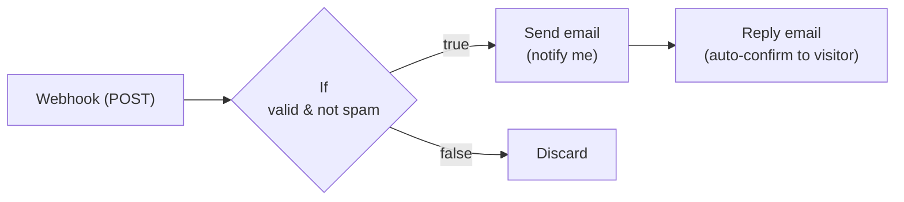
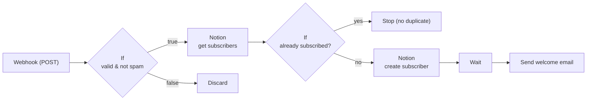
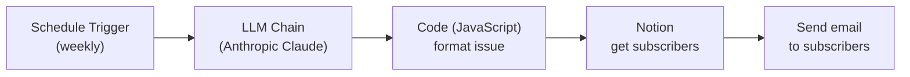
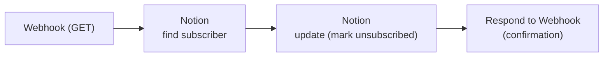

# n8n Automation — Thaus

The automation layer behind [thaus](https://github.com/Tosho-dotcom/thaus)
(the same pattern powers
[zynnth-landing](https://github.com/Tosho-dotcom/zynnth-landing)). The websites
are static front-ends; everything server-side runs as [n8n](https://n8n.io)
workflows that I **self-host on a Linux VPS** (managed with PM2, custom domain).

**Building blocks**

- **Webhooks** — the sites POST form data to n8n over HTTPS.
- **Notion** — used as the subscriber / lead database (create, read, update pages).
- **LLM (Anthropic Claude)** — drafts the weekly newsletter content.
- **Email** — transactional send (notifications, auto-replies, welcome messages).

> No endpoints, tokens or credentials appear in this document or in the site
> repositories. Front-end webhook URLs are injected at build time from
> environment variables; all API credentials live in n8n's encrypted credential
> store.

---

## 1. Contact form

Visitor submits the contact/brief form → n8n validates it (spam/honeypot check),
notifies me, and sends the visitor an automatic confirmation.

## 2. Subscribe (newsletter sign-up)

Sign-up is validated, checked against Notion to avoid duplicates, stored as a new
subscriber, then a welcome email is sent after a short delay.

## 3. Weekly newsletter (AI-generated)

On a schedule, an LLM drafts the issue, a Code node formats it, the active
subscriber list is pulled from Notion, and the newsletter is sent.

## 4. Unsubscribe

A one-click unsubscribe link hits a webhook, the subscriber is found in Notion and
marked inactive, and the webhook returns a confirmation response.

---

## Design notes

- **Notion as a lightweight database.** Create / read / update pages give me a
  full subscriber lifecycle (subscribe → active → unsubscribed) without standing
  up a separate DB, and the data stays readable/editable by hand.
- **Idempotent sign-ups.** The subscribe flow reads Notion first and only creates
  a page when the address is new, so repeat submissions never create duplicates.
- **AI in the loop, not in the client.** The LLM runs inside n8n on the server;
  the browser never talks to a model and never holds an API key.
- **Spam handled at the edge.** A honeypot field on each form plus an `If` gate at
  the start of every inbound flow drops bot traffic before it reaches Notion or
  email.
- **Compliant email.** Every newsletter pairs with a working one-click
  unsubscribe that updates the source of truth in Notion.
